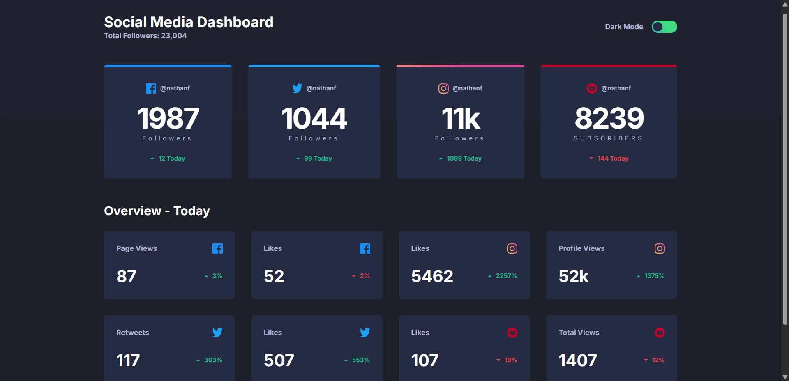

# Frontend Mentor — Social Media Dashboard with Theme Switcher

A responsive social media dashboard built as a [Frontend Mentor](https://www.frontendmentor.io/) challenge. It displays follower counts, daily changes, and an overview of key metrics. Users can switch between light and dark themes.

## Table of Contents

- [Overview](#overview)
- [Features](#features)
- [Built With](#built-with)
- [Getting Started](#getting-started)
- [What I Learned](#what-i-learned)
- [Potential Improvements](#potential-improvements)
- [Useful Resources](#useful-resources)
- [Author](#author)

## Overview

### Features

- Responsive card layout for mobile, tablet, and desktop screens.
- Summary cards showing follower counts and daily changes.
- An `Overview - Today` section with additional statistics.
- Light and dark theme switching.
- Saves the selected theme in `localStorage`.
- Respects the operating system's preferred color scheme on the first visit and follows system theme changes until the user chooses a theme manually.
- Hover states for interactive elements.

### Links

- Challenge: [Frontend Mentor — Social Media Dashboard with Theme Switcher](https://www.frontendmentor.io/challenges/social-media-dashboard-with-theme-switcher-6oY8ozp_H)
- Solution URL: [GitHub](https://github.com/runny-life/social-media-dashboard)
- Live Site URL: [GitHub Pages](https://runny-life.github.io/social-media-dashboard/)

### Screenshot

Add a screenshot of your finished project to the project root (for example, `screenshot.png`) and uncomment or add the following line:



Make sure the image shows your implementation, rather than only the original challenge preview.

## Built With

- **HTML5** — semantic page structure.
- **CSS / SCSS (Sass)** — styling, CSS custom properties, responsive layouts, and modular stylesheets.
- **CSS Grid** — responsive card grids.
- **Flexbox** — alignment and layout within components.
- **JavaScript** — theme switching, `localStorage`, and system preference detection with `matchMedia`.
- **Vite** — local development server and production build tooling.

> React, Next.js, and Styled Components are not used in this project.

## Getting Started

You need [Node.js](https://nodejs.org/) installed to run the project locally.

1. Clone the repository or download the project files.
2. Install the dependencies:

   ```bash
   npm install
   ```

3. Start the development server:

   ```bash
   npm run dev
   ```

4. Create a production build:

   ```bash
   npm run build
   ```

5. Preview the production build locally:

   ```bash
   npm run preview
   ```

## What I Learned

- Organizing SCSS into separate files for base styles, components, layouts, variables, and mixins.
- Building responsive card layouts with CSS Grid and adjusting them for different viewport widths.
- Using CSS custom properties to manage colors and support multiple themes.
- Implementing a theme switcher with JavaScript.
- Persisting a user preference with `localStorage`.
- Detecting and responding to the operating system's color scheme with `matchMedia`.
- Applying basic accessibility practices, including semantic HTML, accessible switch labels, `aria-checked`, and visually hidden headings.

## Potential Improvements

- Test the layout across a wider range of mobile viewport sizes and browser zoom levels.
- Add a clearly visible `:focus-visible` style and verify text contrast in both themes.
- Review the theme switcher's behavior for system, light, and dark preferences. The current control switches between light and dark, while the system preference is used until the user manually selects a theme.
- Respect the `prefers-reduced-motion` media query for animations.
- Fix minor text inconsistencies, including the `Sats followers` typo in a visually hidden heading, and review the accessibility of metric labels.
- If the project grows, consider storing repeated card data in a JavaScript array and rendering the cards from that data. For this small static challenge, keeping the markup in HTML is also a reasonable choice.

## Useful Resources

- [Frontend Mentor](https://www.frontendmentor.io/) — hands-on frontend challenges.
- [MDN: CSS Grid Layout](https://developer.mozilla.org/en-US/docs/Web/CSS/CSS_grid_layout) — a guide to CSS Grid.
- [MDN: CSS custom properties](https://developer.mozilla.org/en-US/docs/Web/CSS/Using_CSS_custom_properties) — documentation for CSS variables.
- [MDN: `localStorage`](https://developer.mozilla.org/en-US/docs/Web/API/Window/localStorage) — storing data in the browser.
- [MDN: `matchMedia()`](https://developer.mozilla.org/en-US/docs/Web/API/Window/matchMedia) — querying and responding to media queries in JavaScript.

## Author

- Frontend Mentor: [Profile](https://www.frontendmentor.io/profile/runny-life)
- GitHub: [Profile](https://github.com/runny-life)
